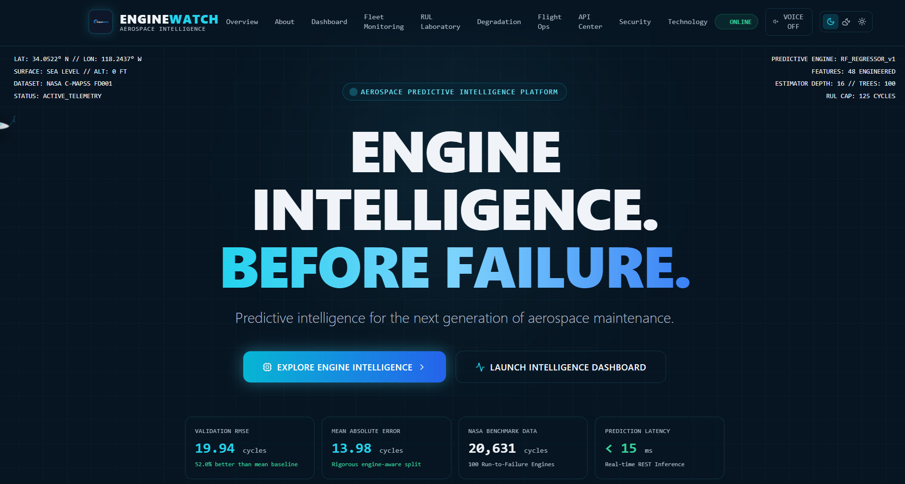
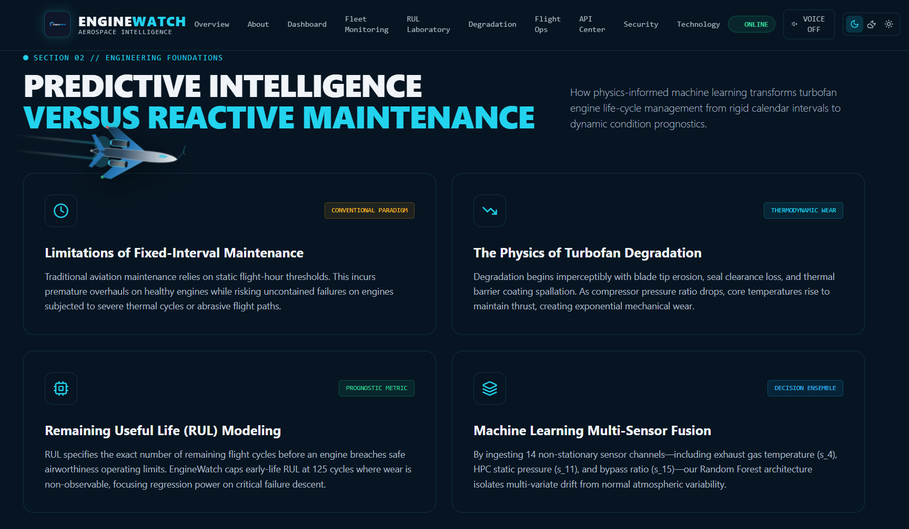
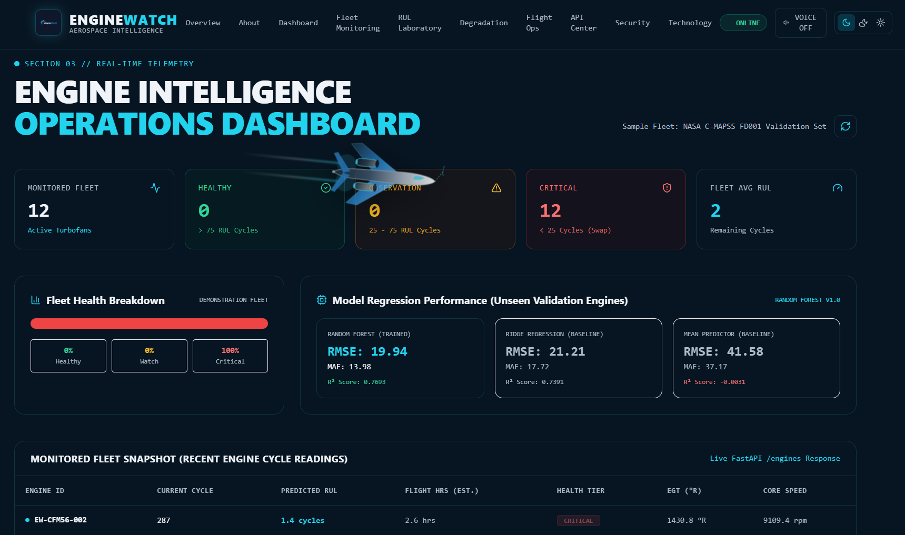
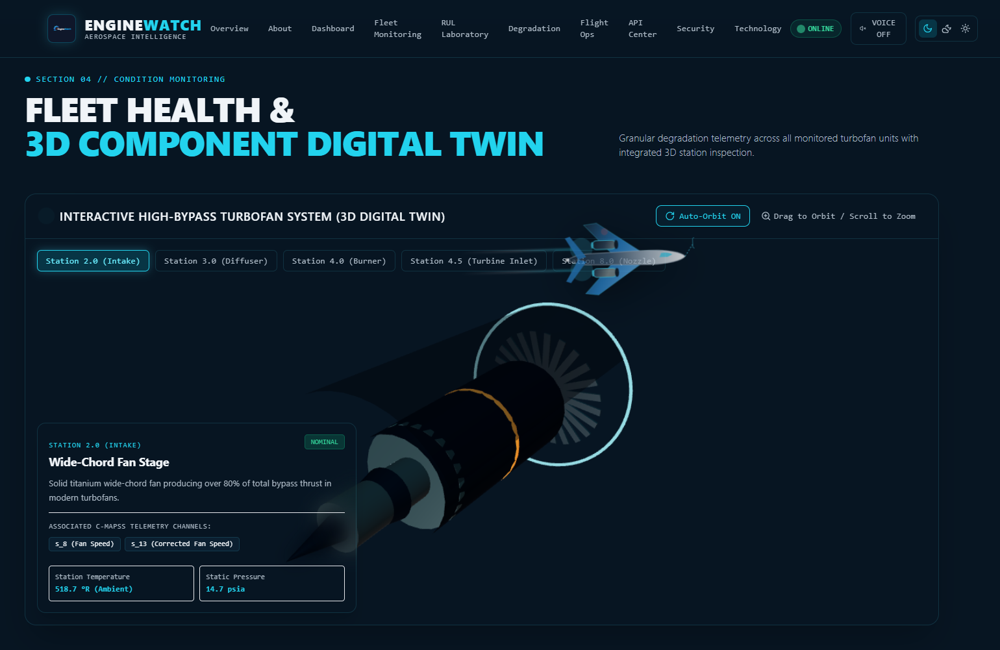
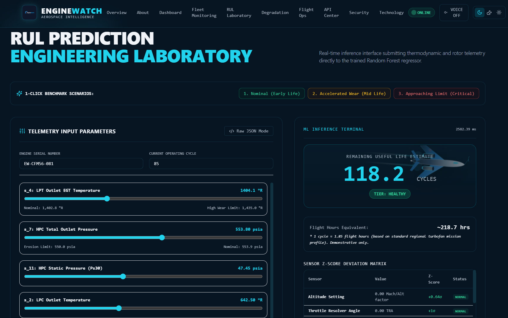
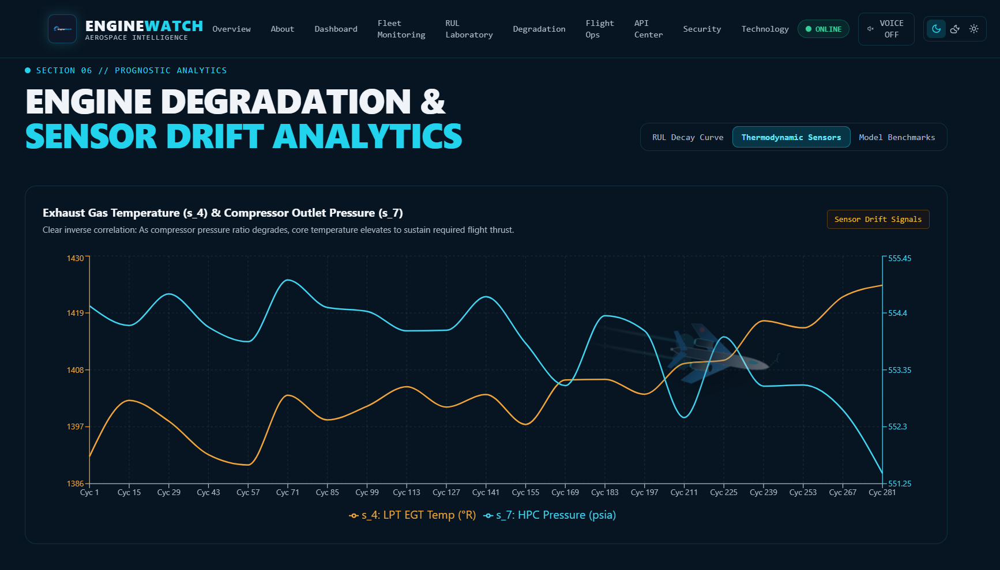
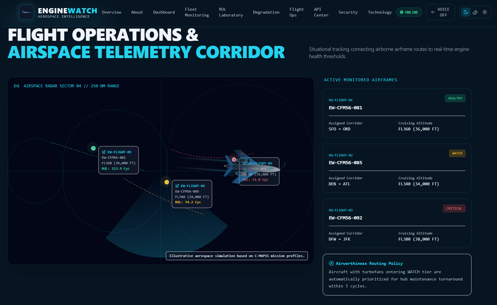
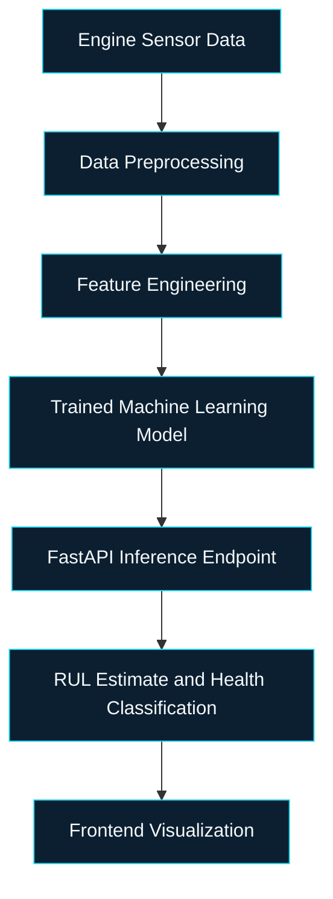

<div align="center">

  

  <h1>EngineWatch</h1>

  <h3>ENGINE INTELLIGENCE. BEFORE FAILURE.</h3>

  <p>
    <strong>AI-Powered Aerospace Predictive Maintenance Intelligence Platform</strong><br/>
    Estimate the Remaining Useful Life (RUL) of turbofan engines with machine learning,<br/>
    sensor analytics and a real-time REST API.
  </p>

  <p>
    
    
    
    
    
  </p>
  <p>
    
    
    
    
  </p>

  <p>
    <a href="https://enginewatch.vercel.app/"></a>
    <a href="https://github.com/dk-khandelwal06/enginewatch"></a>
    <a href="https://www.linkedin.com/in/daksh-khandelwal-b02748391/"></a>
  </p>

  <p>
    <a href="#project-overview">Overview</a> &nbsp;·&nbsp;
    <a href="#platform-preview">Preview</a> &nbsp;·&nbsp;
    <a href="#machine-learning-approach">Machine Learning</a> &nbsp;·&nbsp;
    <a href="#api-architecture">API</a> &nbsp;·&nbsp;
    <a href="#installation-and-setup">Setup</a> &nbsp;·&nbsp;
    <a href="">Demo Video</a>
  </p>

</div>

---

## Table of Contents

- [Project Overview](#project-overview)
- [The Problem](#the-problem)
- [The Solution](#the-solution)
- [Key Features](#key-features)
- [Platform Preview](#platform-preview)
- [How It Works](#how-it-works)
- [Machine Learning Approach](#machine-learning-approach)
- [Model Performance](#model-performance)
- [Technology Stack](#technology-stack)
- [API Architecture](#api-architecture)
- [Installation and Setup](#installation-and-setup)
- [Environment Variables](#environment-variables)
- [Live Demo](#live-demo)
- [GitHub Repository](#github-repository)
- [Author](#author)
- [Disclaimer](#disclaimer)

---

## Project Overview

**EngineWatch** is an aerospace predictive-maintenance platform that analyzes turbofan engine telemetry and estimates how many operating cycles an engine has left before it reaches the end of its useful life.

A trained Random Forest model sits behind a validated FastAPI service. A Next.js interface turns its output into a monitoring dashboard, a prediction laboratory, degradation analytics and an interactive 3D turbofan.

Engine maintenance is expensive and safety-critical. EngineWatch explores a **condition-based** alternative to fixed schedules: use what each engine's sensors are actually reporting to estimate remaining life, flag accelerated wear early, and explain the readings behind the estimate.

> EngineWatch is trained on **simulated** engine data (NASA C-MAPSS FD001). It is a research and demonstration platform, not a certified maintenance tool. See the [Disclaimer](#disclaimer).

---

## The Problem

Conventional maintenance relies on fixed intervals such as flight-hour or calendar thresholds. That approach has structural limits:

- **Fixed schedules ignore condition.** Two engines with the same hours can be in very different states of wear.
- **Unnecessary maintenance.** Healthy engines can be pulled for work they do not yet need.
- **Accelerated wear is hard to spot.** Degradation starts subtly, and drift is spread across many sensors rather than one obvious alarm.
- **Sensor variability.** Every engine has its own initial wear and manufacturing variation, so raw readings alone are noisy and hard to compare.

---

## The Solution

EngineWatch replaces a calendar-based view with a data-driven one:

| Stage | What EngineWatch does |
|---|---|
| **Sensor analysis** | Uses 14 informative sensor channels and 2 operating settings; constant sensors are dropped |
| **Feature engineering** | Adds 5-cycle rolling mean and standard deviation per channel (16 raw + 16 mean + 16 std = 48 features) |
| **RUL estimation** | A Random Forest regressor predicts Remaining Useful Life in operating cycles |
| **Health classification** | Maps the estimate to `HEALTHY`, `WATCH` or `CRITICAL` |
| **REST inference** | Serves predictions through a validated FastAPI endpoint |
| **Interactive analytics** | Visualizes fleet state, sensor drift and per-sensor deviation in the browser |

---

## Key Features

| Feature | Description |
|---|---|
| **Cinematic aircraft animation** | Scroll-linked aircraft animation across the page; respects `prefers-reduced-motion` |
| **Interactive 3D turbofan** | Three.js turbofan with orbit and zoom controls and clickable engine-station hotspots linked to C-MAPSS sensor channels |
| **Dark, Medium and Light modes** | Three appearance modes, remembered in the browser |
| **Optional voice narration** | Browser `SpeechSynthesis` guide; off by default, and paused while you type in a form field |
| **Engine monitoring dashboard** | Fleet summary and a live table from the `/engines` endpoint |
| **RUL prediction laboratory** | Adjust 16 telemetry inputs, load one of three presets, or submit raw JSON, and get a live RUL estimate and health tier |
| **Sensor deviation analysis** | Per-sensor z-scores against nominal baselines, labeled `NORMAL`, `ELEVATED` or `WARNING` |
| **Degradation analytics** | Charts for RUL decay, sensor drift and model benchmarks |
| **Flight operations view** | An *illustrative* radar-style visualization built on simulated mission profiles. It does not use live flight data |
| **FastAPI integration** | Frontend talks to a typed REST API |
| **API documentation** | In-app API Center with a live request tester, plus interactive Swagger UI at `/docs` and ReDoc at `/redoc` |
| **Security and validation** | Pydantic bounds on every sensor, CORS control, rate limiting, payload size cap and security headers |

---

## Platform Preview

<div align="center">

  <h3>01 — Overview</h3>
  
  <p><em>The EngineWatch aerospace intelligence landing experience, with headline model metrics and navigation to every module.</em></p>

  <br/>

  <h3>02 — About</h3>
  
  <p><em>Why predictive maintenance matters: the limits of fixed-interval maintenance, turbofan degradation, RUL modeling and multi-sensor fusion.</em></p>

  <br/>

  <h3>03 — Dashboard</h3>
  
  <p><em>The operations dashboard: a 12-engine demonstration fleet drawn from the C-MAPSS validation split, with side-by-side model performance.</em></p>

  <br/>

  <h3>04 — Fleet Monitoring</h3>
  
  <p><em>An interactive 3D turbofan digital twin with station hotspots linked to the sensor channels measured there.</em></p>

  <br/>

  <h3>05 — RUL Prediction Laboratory</h3>
  
  <p><em>Tune telemetry inputs or load a benchmark scenario, then read the RUL estimate, health tier and sensor z-score matrix returned by the API.</em></p>

  <br/>

  <h3>06 — Degradation Analytics</h3>
  
  <p><em>Sensor drift across an engine's operating cycles, such as exhaust gas temperature rising as compressor outlet pressure falls.</em></p>

  <br/>

  <h3>07 — Flight Operations</h3>
  
  <p><em>An illustrative airspace radar view that links simulated airframes to engine health tiers. Routes and altitudes are demonstrative.</em></p>

</div>

---

## How It Works



1. **Telemetry in.** The client sends the current sensor readings, and optionally a few recent cycles.
2. **Validation.** Pydantic enforces physical bounds on every value and rejects out-of-range input with HTTP `422`.
3. **Features.** Rolling mean and standard deviation are computed, then scaled with the scaler fitted during training.
4. **Inference.** The Random Forest returns an RUL estimate, clipped to the 0–125 cycle range.
5. **Interpretation.** The API adds a health tier and a per-sensor deviation analysis, and the frontend renders it.

---

## Machine Learning Approach

| Step | Implementation |
|---|---|
| **Dataset** | NASA C-MAPSS **FD001**: 100 simulated run-to-failure engines, 20,631 operating cycles, a single operating condition |
| **RUL target** | For each engine, `RUL = last cycle − current cycle` |
| **RUL capping** | RUL is capped at **125 cycles**, because early-life wear is hard to observe and a flat early target is easier to learn |
| **Sensor selection** | 14 informative sensors (`s_2`, `s_3`, `s_4`, `s_7`, `s_8`, `s_9`, `s_11`, `s_12`, `s_13`, `s_14`, `s_15`, `s_17`, `s_20`, `s_21`) plus `setting_1` and `setting_2`; constant channels are dropped |
| **Rolling features** | Per-engine rolling mean and standard deviation over a 5-cycle window |
| **Scaling** | `StandardScaler`, fitted on training engines only |
| **Validation split** | **Engine-aware** 80/20 split: 80 training engines, 20 held-out validation engines |
| **Baselines** | Mean predictor and Ridge regression (`alpha = 100`) |
| **Final model** | `RandomForestRegressor`: 100 trees, `max_depth=16`, `min_samples_split=5`, `min_samples_leaf=2`, `random_state=42` |
| **Metrics** | RMSE, MAE, R², plus the asymmetric NASA PHM scoring function and early-versus-late error breakdown |

**Why engine-aware validation matters.** Rows from the same engine are strongly correlated. A random row-level split would put neighboring cycles of one engine in both training and validation, so the model would be scored on engines it had effectively already seen. Splitting by engine measures how well the model generalizes to engines it has never encountered.

**Data provenance.** The model is trained on simulated degradation data. It has **not** been trained or validated on real airline engine telemetry.

---

## Model Performance

Validation results on the 20 held-out engines (4,291 cycles):

| Model | RMSE (cycles) | MAE (cycles) | R² |
|---|:---:|:---:|:---:|
| **Random Forest** | **19.94** | **13.98** | **0.7693** |
| Ridge Regression | 21.21 | 17.72 | 0.7391 |
| Mean Predictor | 41.58 | 37.17 | −0.0031 |

Reading the numbers honestly:

- The Random Forest improves on both baselines for RMSE, MAE and R².
- On this split the Random Forest's *late-prediction* error (MAE 20.28 cycles) is larger than its *early-prediction* error (MAE 10.06 cycles). Late predictions overestimate remaining life and are the riskier direction.
- On the asymmetric NASA scoring function, the Ridge baseline scores lower (better) than the Random Forest on this split. The full breakdown is available from the `/metrics` endpoint.

> These are **benchmark validation results on simulated data**, evaluated over all cycles of the held-out engines. They are not guarantees of real-world engine performance.

---

## Technology Stack

| Layer | Technologies |
|---|---|
| **Frontend** | Next.js 14 (App Router), React 18, TypeScript, Tailwind CSS, Framer Motion, Three.js, Recharts, Lucide Icons |
| **Backend** | Python, FastAPI, Pydantic v2, Uvicorn |
| **Machine Learning** | Pandas, NumPy, scikit-learn, Joblib |
| **Testing** | pytest, HTTPX |
| **Deployment** | Vercel (frontend); Render (backend, per the deployment guide in `docs/`) |

---

## API Architecture

The backend is a FastAPI application that loads the trained model, scaler and metadata once at startup, validates every request with Pydantic, and returns typed JSON responses.

| Method | Endpoint | Purpose |
|---|---|---|
| `GET` | `/health` | Service status and whether the model is loaded |
| `POST` | `/predict` | RUL estimate, health tier and sensor deviation analysis |
| `GET` | `/model/info` | Model configuration, feature list and top-10 feature importances |
| `GET` | `/metrics` | Validation metrics for all three models |
| `GET` | `/engines` | Summary of the 12-engine demonstration fleet |
| `GET` | `/engines/{unit_id}` | Degradation history for one engine |
| `GET` | `/preset-inputs` | Three ready-made telemetry scenarios for the laboratory |

Interactive documentation is served at `/docs` (Swagger UI) and `/redoc`.

**Prediction workflow.** `/predict` accepts the current `readings` and, optionally, `historical_cycles` from recent cycles. The API computes rolling mean and standard deviation across the supplied readings, scales the 48-feature vector, runs the Random Forest, and clips the result to 0–125 cycles. When no history is supplied, the rolling features reduce to the current reading with a standard deviation of zero.

**Health tiers.**

| Tier | Predicted RUL |
|---|---|
| `HEALTHY` | more than 75 cycles |
| `WATCH` | 25 to 75 cycles |
| `CRITICAL` | fewer than 25 cycles |

**Example request**

```bash
curl -X POST "http://127.0.0.1:8000/predict" \
  -H "Content-Type: application/json" \
  -d '{
    "engine_id": "EW-CFM56-081",
    "current_cycle": 18,
    "readings": {
      "setting_1": -0.0007, "setting_2": -0.0004,
      "s_2": 642.12, "s_3": 1581.15, "s_4": 1398.92, "s_7": 554.45,
      "s_8": 2388.06, "s_9": 9051.10, "s_11": 47.18, "s_12": 522.25,
      "s_13": 2388.05, "s_14": 8139.80, "s_15": 8.398, "s_17": 391.0,
      "s_20": 39.02, "s_21": 23.41
    }
  }'
```

The response contains `predicted_rul_cycles`, `health_status`, `inference_time_ms`, a `sensor_analysis` list and the standard disclaimer.

**Security and validation controls**

- Pydantic bounds reject physically impossible sensor values with HTTP `422`.
- In-memory sliding-window rate limiter: 120 requests per minute per client IP by default.
- Requests larger than 1 MB are rejected with HTTP `413`.
- CORS origins are configurable, and only `GET`, `POST` and `OPTIONS` are allowed.
- Responses include `X-Content-Type-Options` and `X-Frame-Options` headers.

---

## Installation and Setup

**Requirements:** Python 3.10 or newer (developed on Python 3.13) and Node.js 18.17 or newer with npm.

### Backend

```bash
git clone https://github.com/dk-khandelwal06/enginewatch.git
cd enginewatch

pip install -r backend/requirements.txt

# Optional: run the test suite
pytest backend/tests -v

# Start the API from the repository root
python -m uvicorn backend.app.main:app --host 127.0.0.1 --port 8000 --reload
```

The API is now available at `http://127.0.0.1:8000`, with documentation at `http://127.0.0.1:8000/docs`.

Trained model artifacts are committed to the repository in `backend/models/`, so you do **not** need to retrain to run the API.

<details>
<summary><strong>Optional: retrain the model</strong></summary>

<br/>

The raw training file is not committed to the repository. Download the **C-MAPSS Turbofan Engine Degradation Simulation** dataset from the [NASA Prognostics Data Repository mirror (PHM Society)](https://data.phmsociety.org/nasa/), then place `train_FD001.txt` in `backend/data/`:

```bash
python backend/src/train.py
```

This retrains the Random Forest and both baselines, then rewrites the artifacts and metrics in `backend/models/`.

</details>

### Frontend

```bash
cd frontend
npm install
npm run dev
```

Open `http://localhost:3000`. For a production build, run `npm run build` followed by `npm start`.

---

## Environment Variables

Copy the example files and adjust the values. Never commit real `.env` files.

| Variable | Purpose | Required |
|---|---|---|
| `NEXT_PUBLIC_API_URL` | Base URL of the FastAPI backend, read by the frontend. Defaults to `http://127.0.0.1:8000` | Required in production |
| `CORS_ORIGINS` | Comma-separated list of allowed browser origins, read by the backend. Defaults to `*` | Recommended in production |
| `RATE_LIMIT_MAX` | Maximum requests per minute per client IP. Defaults to `120` | No |

```bash
# frontend/.env.local
NEXT_PUBLIC_API_URL=http://127.0.0.1:8000

# backend (environment)
CORS_ORIGINS=http://localhost:3000,https://your-frontend-domain.example
RATE_LIMIT_MAX=120
```

> List allowed origins explicitly. Wildcard patterns inside a list entry, such as `https://*.vercel.app`, are not matched by the CORS middleware.
>
> `PORT` and `HOST` also appear in `.env.example`, but the application does not read them. The port is set on the Uvicorn command line, and hosting platforms inject their own.

---

## Live Demo

<div align="center">

  <h3>
    <a href="https://enginewatch.vercel.app/">▶ Launch EngineWatch → enginewatch.vercel.app</a>
  </h3>

</div>

---

## GitHub Repository

Source code, documentation and issue tracking:

**[github.com/dk-khandelwal06/enginewatch](https://github.com/dk-khandelwal06/enginewatch)**

Further reading lives in the repository's `docs/` folder: `architecture.md`, `api_reference.md` and `deployment_guide.md`.

---

## Author

<div align="center">

  **Daksh Khandelwal**

  <a href="https://www.linkedin.com/in/daksh-khandelwal-b02748391/">
    
  </a>

</div>

---

## Disclaimer

> **EngineWatch provides experimental predictive-maintenance estimates based on simulated engine degradation data. Predictions are not certified airworthiness assessments and must not be used as the sole basis for flight-safety or maintenance decisions.**

- The data is simulated. The "cycles" in EngineWatch are **simulated engine operating cycles** from NASA C-MAPSS, not actual commercial flights.
- Any conversion to flight hours (1 cycle ≈ 1.85 hours) is a demonstrative assumption.
- Engine serial numbers, routes and altitudes shown in the interface are illustrative.
- EngineWatch does not connect to flight-tracking or airline systems.

---

<div align="center">

  

  <p>
    <strong>Built with precision, powered by intelligence.</strong><br/>
    <sub>EngineWatch — Aerospace Predictive Maintenance Intelligence.</sub>
  </p>

  <p>
    <a href="https://enginewatch.vercel.app/">Live Demo</a> &nbsp;·&nbsp;
    <a href="https://github.com/dk-khandelwal06/enginewatch">GitHub</a> &nbsp;·&nbsp;
    <a href="https://www.linkedin.com/in/daksh-khandelwal-b02748391/">LinkedIn</a> &nbsp;·&nbsp;
    <a href="#table-of-contents">Back to contents</a>
  </p>

</div>
